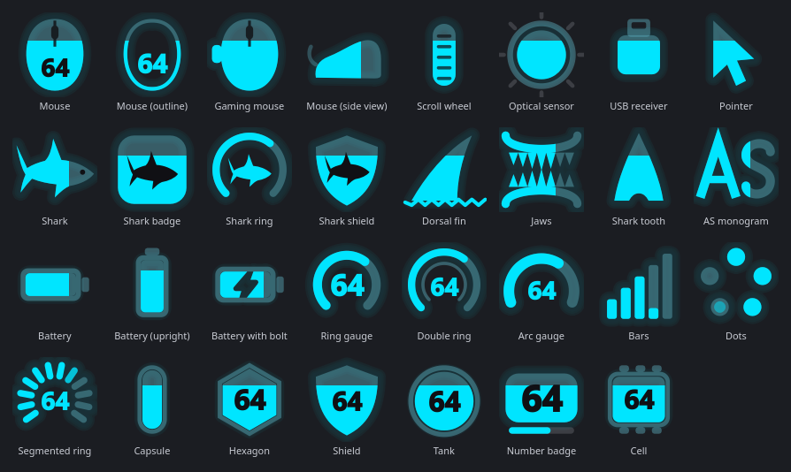
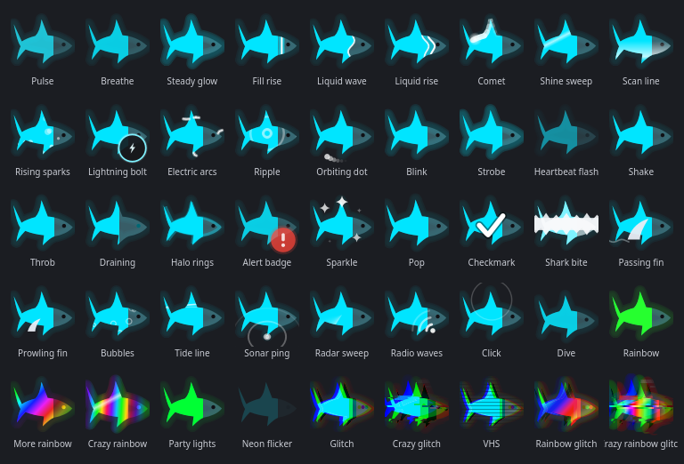

# Attack Shark Battery KDE

Tray icon for the battery of **Attack Shark wireless mice** on Linux — the ones
that ship with the Xenta `1d57:fa60` 2.4 GHz receiver.

Built for KDE Plasma on Wayland, and it works on any desktop with a
StatusNotifierItem tray.



Written in PySide6 (Qt 6), so the tray icon is a native **StatusNotifierItem**:
no XWayland, no legacy system tray.

---
## Attack Shark V6 Support -  Linux / KDE / 2.4 GHz

**Attack Shark V6 battery monitoring is now supported through a tested patch!**

This fork includes support for reading the Attack Shark V6 battery percentage and charging status directly from its 2.4 GHz USB receiver on Linux, without Windows software or Bluetooth.

**Tested configuration:**

- Mouse: Attack Shark V6
- Receiver: `1d57:fa60`
- Operating system: Arch Linux
- Desktop: KDE Plasma
- Battery percentage and charging status successfully displayed in the system tray.

The V6 uses a different battery report header (`03 24 41`) from the original supported models (`03 E5 40`). Both formats are supported by the patch.

**Get the V6-compatible version:** [V6 support branch](https://github.com/johanlr/Attack-Shark-Battery-KDE/tree/add-attack-shark-v6)

**Upstream contribution:** [Pull Request #2  Add Attack Shark V6 battery support](https://github.com/gabrielmf1998/Attack-Shark-Battery-KDE/pull/2)

The V6 patch is awaiting upstream review. Until merged, use the V6 support branch rather than the default branch.


## Why this exists

This mouse reports **no battery at all over standard HID**. Its report
descriptors have no Battery Strength field and no power device page, so
`/sys/class/power_supply` stays empty and `upower`, the panel's battery widget
and tools like `wireless-hid` have nothing to read. No driver fills the gap
either — the vendor ships Windows software and that is it.

The battery *is* on the wire, though. The receiver's vendor interface pushes a
five byte frame every couple of seconds:

```
03 E5 40 ST NN
         │  └─ battery level, 0–100 (%)
         └──── state: 01 = on battery, 03 = charging
```

That reading was established by measurement, not by guessing:

| Observation | What it rules out |
|---|---|
| Saturates at exactly `0x64` = 100 | fixes the scale as a percentage |
| Falls on its own, ~1 point per 30 min, without reconnecting | a value frozen at boot |
| Rises while a cable is in, and `ST` matched three timed charging windows | `ST` being anything but a charge flag |
| Does not move under heavy mouse movement | instantaneous voltage, and signal strength |

## Two traps it handles for you

**The false zero.** The receiver slips in `03 E5 01 00 00` frames (byte 2 is
`01` instead of `40`) whenever the link blinks. Read one of those as a battery
frame and you get **0%** — and a critical-battery alarm on a full battery. Only
`03 E5 40 …` counts here.

**Silence is not an empty battery.** Plug the charging cable into the PC and
the mouse leaves the radio entirely: the receiver goes quiet and the mouse
shows up as a different USB device (`1d57:2155`). Walking away long enough puts
it to sleep, too. In both cases the app holds the last level it was told, marks
the state as asleep, and raises no alarm.

## Time remaining

The mouse reports a percentage and nothing else, so there is no time to read
anywhere — it has to be measured, on this machine, with this mouse.

The signal falls one point every half hour or so, which makes a least-squares
fit over the recent window mostly measure the rounding. What the signal really
offers is the **interval between steps**, a direct measure of how long one
percentage point lasts. The app keeps those intervals and uses the **median**,
which survives one odd step.

A step only counts if the level moved 1–3 points, the elapsed time is plausible
(minutes, not seconds or hours), and the mouse stayed awake throughout — a step
that spans a night of sleep would claim the battery lasts a week.

One more correction earns its keep: for about 20 minutes after the cable comes
out, the gauge still drops fast — surface charge going away, not real use.
Measured on this hardware: **13 min per point right after a charge against ~36
min an hour later**. Without that grace period the estimate comes out nearly
half of what it should be.

Charging is measured the same way, in the other direction.

Nothing here is a guess: with too little measured, the app says what it is
still waiting for instead of inventing a number.

## Reading it without root

Installation adds one udev rule that opens **only the receiver's vendor
interface** — never the keyboard and mouse interfaces of the same dongle, which
would hand any process running as you your keystrokes over hidraw.

Two things about that rule are worth knowing if you ever edit it:

* the obvious `ATTRS{idVendor}` + `ATTRS{bInterfaceNumber}` pair **matches
  nothing**, because those attributes live on different parent devices and udev
  requires all `ATTRS` in one rule to match on the same device. The rule matches
  the interface's `modalias` instead, which carries both;
* the filename has to sort **before** `73-seat-late.rules`, or the `uaccess`
  tag lands after the builtin that applies the ACL and the device stays
  root-only.

## Install

```sh
./install.sh
```

Per-user; the only step that needs root is the udev rule, and it asks once.
Then start it:

```sh
attackshark-tray
```

Tick **Start at login** in the tray menu (or `systemctl --user enable --now
attackshark-tray`) to have it come back on its own.

## What you can change



* **31 icon styles** — the mouse itself, the shark, and plain gauges
* **45 animations**, any of them on any style, per event (charging, full, low,
  critical, idle, asleep)
* **42 colour schemes**, including level-based, gradients and a custom picker
* **Icon size** independent of the panel's cell, glow, line weight, and the
  percentage drawn inside the icon
* **Thresholds** for low and critical, and how often a warning repeats
* **Sounds** per event, taken from the sound themes already on the machine —
  nothing bundled, nothing downloaded, or point it at any file you like

Everything applies as you change it, with a live preview of the real icon.

## Requirements

* Linux with a StatusNotifierItem tray (KDE Plasma, or GNOME with the
  AppIndicator extension)
* Python 3.10+ and PySide6
* An Attack Shark mouse on the `1d57:fa60` receiver

Nothing in this app touches the network.

## Licence

MIT — see [LICENSE](LICENSE).
